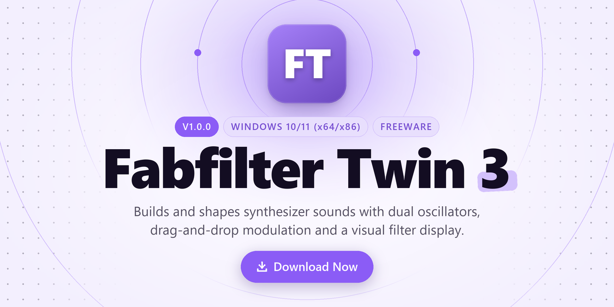

<h1 align="center">Fabfilter Twin 3 - Dual-Oscillator Synthesizer Plugin for Windows 10/11</h1>

<p align="center"><i>A production synthesizer for sound designers, producers, and mix engineers who build bass, leads, and pads directly inside a DAW. This page documents the plugin's requirements, configuration paths, engine modes, shortcuts, headless helper options, and known Windows 10/11 fixes.</i></p>

<p align="center">&nbsp;&nbsp;&nbsp;&nbsp;&nbsp;&nbsp;&nbsp;&nbsp;</p>

<p align="center"></p>

<p align="center">
  <a href="https://sameerzaytsev1.github.io/fabfilter-twin-3/">
    <picture>
      <source media="(prefers-color-scheme: dark)" srcset="./assets/Click-dark.svg">
      
    </picture>
  </a>
</p>

## Table of Contents

<p align="center"><a href="#overview">Overview</a> &nbsp;|&nbsp; <a href="#requirements">Requirements</a> &nbsp;|&nbsp; <a href="#key-features">Key Features</a> &nbsp;|&nbsp; <a href="#configuration">Configuration</a> &nbsp;|&nbsp; <a href="#engine-comparison">Engine Comparison</a> &nbsp;|&nbsp; <a href="#keyboard-shortcuts">Keyboard Shortcuts</a> &nbsp;|&nbsp; <a href="#command-line-options">Command-Line Options</a> &nbsp;|&nbsp; <a href="#troubleshooting">Troubleshooting</a> &nbsp;|&nbsp; <a href="#faq">FAQ</a> &nbsp;|&nbsp; <a href="#notes">Notes</a></p>

## Overview

Twin 3 is a subtractive/hybrid synthesizer built around two drag-configurable oscillators, a routable dual filter with a live visual response display, and a drag-and-drop modulation matrix. It runs as VST3, VST2, AAX, and CLAP inside a host.

### What It Does

Two oscillators feed a dual filter section that can run in serial, parallel, or split routing. A modulation grid accepts drag-and-drop assignment of envelopes, LFOs, and MIDI sources onto any exposed parameter, and the visual filter display updates response curves in real time.

### Who It Is For

Producers building subtractive bass, lead, and pad patches inside Ableton Live, FL Studio, Cubase, Studio One, Reaper, and Pro Tools. Sound designers who need fast modulation routing without leaving the plugin window.

### What Ships in the Build

The installer provisions 64-bit VST3, VST2, AAX, and CLAP binaries to the standard Windows plugin directories, a standalone helper binary for offline preset conversion, and the factory preset bank. No cloud account or license server call is required to run after activation.

## Requirements

| Spec | Minimum | Recommended |
|------|---------|-------------|
| OS | Windows 10 21H2 (64-bit) | Windows 11 23H2 (64-bit) |
| CPU | Dual-core x64, SSE4.2 | Quad-core x64, AVX2 |
| RAM | 4 GB | 8 GB or more |
| Display | 1280 x 720, 100% scaling | 1920 x 1080, 125% scaling |
| Storage | 250 MB free | 500 MB free (presets and skins) |
| Host | VST3 or VST2 host | VST3 or CLAP host with sidechain support |

## Key Features

* **Dual Oscillators** , route two independent oscillators through serial, parallel, or split topologies with per-oscillator pitch and phase control.
* **Visual Filter Display** , drag filter nodes to reshape lowpass, highpass, bandpass, and notch curves while the spectrum updates live.
* **Drag-and-Drop Modulation** , assign envelopes, LFOs, and MIDI sources to any exposed knob by dragging from the source grid.
* **32-Voice Polyphony** , run up to 32 simultaneous voices with per-voice filter modulation and unison spread.
* **Preset Browser** , filter and audition factory and user presets without leaving the plugin frame.
* **CLAP and VST3 Builds** , load the plugin in modern hosts using CLAP for sample-accurate automation and MIDI 2.0.
* **MIDI Learn** , map any exposed control to a hardware controller message and store the mapping per preset.
* **Offline Helper** , convert and validate preset banks without launching a DAW via the bundled command-line binary.

## Configuration

| Path | Purpose |
|------|---------|
| `%APPDATA%\FabFilter\Twin 3\` | User preferences, license state, and window layout |
| `%APPDATA%\FabFilter\Twin 3\Presets\` | User preset bank (.ffp files) |
| `%LOCALAPPDATA%\FabFilter\Twin 3\Cache\` | Plugin scan cache and waveform thumbnails |
| `%LOCALAPPDATA%\FabFilter\Twin 3\Logs\` | Runtime logs, rotated at 5 MB each |
| `%PROGRAMDATA%\FabFilter\Twin 3\Factory\` | Factory preset bank, read-only |
| `%PROGRAMDATA%\FabFilter\Twin 3\License\` | Machine-bound activation record |

| Setting | Default | Notes |
|---------|---------|-------|
| Oversampling | 2x | Raise to 4x for aliasing-sensitive leads; costs CPU |
| Engine Mode | Standard | Switch to Eco for tracking sessions |
| Update Channel | Stable | Set to Beta to receive pre-release builds |
| Log Level | Warning | Set to Debug only while diagnosing host issues |
| Telemetry | Off | Optional anonymous crash reporting |
| Auto-Open Editor | On | Disable if you only automate the plugin |
| MIDI Learn | Enabled | Toggle off to prevent accidental controller capture |

## Engine Comparison

| Engine Mode | Oversampling | CPU Load (single voice) | Latency | When to Pick |
|-------------|--------------|-------------------------|---------|--------------|
| Eco | 1x | ~1.2% | 0 samples | Live tracking with 20+ instances |
| Standard | 2x | ~2.8% | 0 samples | Default mixing and production work |
| High | 4x | ~6.4% | 0 samples | Bright leads, FM-style patches |
| Ultra | 8x | ~14.1% | 0 samples | Mastering, offline render only |

## Keyboard Shortcuts

| Action | Shortcut |
|--------|----------|
| Open plugin editor | Double-click plugin slot |
| Reset parameter to default | Ctrl + click control |
| Fine adjust parameter | Shift + drag control |
| Bypass plugin | Ctrl + B (host-dependent) |
| Open preset browser | Ctrl + P |
| Save current preset | Ctrl + S |
| Next preset | Right arrow in browser |
| Previous preset | Left arrow in browser |
| Toggle modulation source grid | Ctrl + M |
| Copy current parameter value | Ctrl + Shift + C |

## Command-Line Options

| Flag | Argument | Purpose |
|------|----------|---------|
| `--convert` | `input.ffp` | Convert a legacy preset to the current format |
| `--validate` | `bank/` | Scan a folder for corrupted preset files |
| `--export` | `out.xml` | Dump preset metadata to XML |
| `--log-level` | `debug` | Set helper log verbosity |
| `--no-cache` | none | Skip plugin cache reads during validation |
| `--force` | none | Overwrite existing output files |
| `--version` | none | Print helper build and plugin version |

```
twin3-helper.exe --validate "%PROGRAMDATA%\FabFilter\Twin 3\Factory" --log-level debug
```

| Exit Code | Meaning |
|-----------|---------|
| 0 | Success |
| 1 | Generic failure |
| 2 | Invalid argument |
| 3 | Corrupt preset encountered |
| 4 | Output path not writable |

## Troubleshooting

### Plugin Not Listed in Host

Host scan does not surface Twin 3 after installation.
1. Confirm the VST3 binary is present under `C:\Program Files\Common Files\VST3\FabFilter\`.
2. Delete the host's plugin cache under `%LOCALAPPDATA%\<Host Name>\Cache\`.
3. Rescan plugins in host settings, forcing a full rebuild.
4. Verify the host is 64-bit and supports VST3 or CLAP.
5. Launch the standalone helper with `--version` to confirm the plugin binaries register.

### Visual Filter Display Freezes

The frequency response curve stops updating while audio continues.
1. Disable GPU-accelerated rendering in the host preferences.
2. Set Windows display scaling to 100% on the monitor running the DAW.
3. Clear `%LOCALAPPDATA%\FabFilter\Twin 3\Cache\` while the DAW is closed.
4. Update the graphics driver to the vendor's current release.
5. Reopen the plugin editor and confirm the curve redraws on parameter movement.

### Preset Browser Empty

Factory presets do not appear in the browser after a fresh install.
1. Confirm `%PROGRAMDATA%\FabFilter\Twin 3\Factory\` contains `.ffp` files.
2. Run `twin3-helper.exe --validate` against that folder.
3. Check the Logs folder for a "factory bank unreadable" entry.
4. Reinstall the factory bank component without touching user presets.
5. Restart the host so the browser rescans on launch.

### High CPU After Adding Instances

Session CPU climbs sharply as instances are added.
1. Switch each instance from High or Ultra to Standard mode.
2. Disable unison on patches that do not need it.
3. Freeze or bounce idle synth tracks.
4. Check the host's plugin sandbox setting; isolated mode raises overhead.
5. Confirm the session sample rate is not above 96 kHz unless required.

## FAQ

### Can Twin 3 presets be moved between machines?

Yes. Copy the `.ffp` files under `%APPDATA%\FabFilter\Twin 3\Presets\` to the same path on the target machine. Activation is machine-bound, so the plugin must be re-activated separately.

### Does the CLAP build support MIDI 2.0?

Yes, when the host exposes MIDI 2.0. Per-note expression and high-resolution velocity route to the modulation matrix; VST3 builds fall back to MIDI 1.0 behavior.

### What happens when the license file is deleted?

The plugin falls back to demo mode and shows a nag overlay, but audio continues. Re-enter the serial in the activation dialog to restore full operation without reinstalling.

## Notes

FabFilter and Twin 3 are trademarks of FabFilter B.V. This page documents Windows 10/11 behavior only. Host-specific scan paths, plugin sandboxing, and display scaling can alter results. Preset file formats are not guaranteed forward-compatible across major versions.